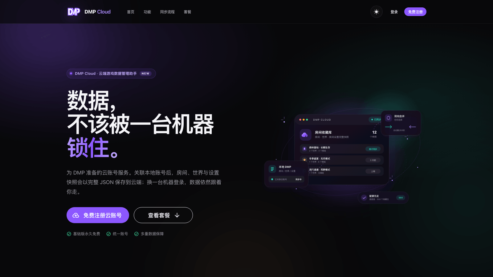
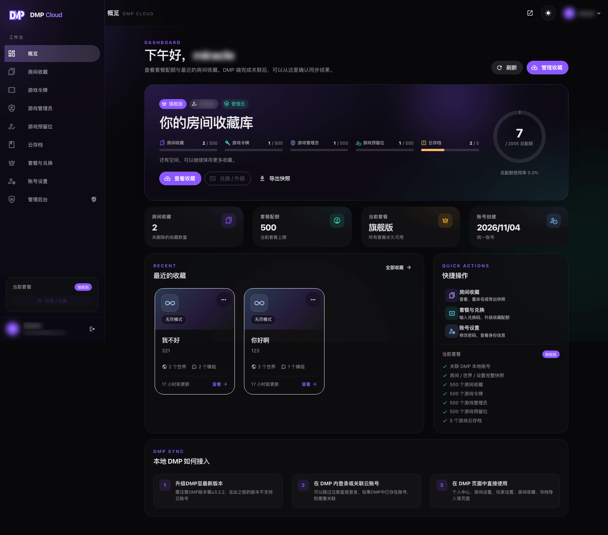

::: warning
该页面内容由AI生成，如有疑问请提交[issue](https://github.com/miracleEverywhere/dst-management-platform-docs)
:::

::: info
云账号是 DMP 的云端数据服务，由 [DMP Cloud](https://dmp-cloud.miraclesses.top/) 提供，需要 DMP `v3.2.2` 及以上版本。
:::

DMP 本身可以完全离线使用。云账号解决的是另一类问题：换一台机器、重装系统、误删配置之后，房间的「配置」和「令牌」还能不能找回来。

云账号不是 DMP 本地账号的替代品。本地账号决定你能在这台 DMP 上做什么，云账号负责把数据带到下一台 DMP。

## 云端保存什么

- **房间收藏**：房间、世界列表与房间设置的完整 JSON 快照，恢复时不依赖原服务器
- **游戏令牌**：常用的饥荒游戏令牌，可在 DMP 房间设置里直接选用
- **游戏管理员 / 预留位**：UID、昵称与备注，开服时可以直接添加到玩家列表
- **云存档**：房间存档 zip（仅旗舰版），单个不超过 `50MB`

::: tip
收藏保存的是「配置快照」，不包含存档文件、模组文件和地图。需要保存完整房间数据时，请使用云存档。
:::

## 套餐与配额

| 能力         | 基础版 | 高级版 | 旗舰版  |
|------------|-----|-----|------|
| 房间收藏       | 1   | 20  | 500  |
| 游戏令牌       | 1   | 20  | 500  |
| 游戏管理员      | 1   | 20  | 500  |
| 游戏预留位      | 1   | 20  | 500  |
| 云存档        | 不支持 | 不支持 | 5 个  |

配额只统计「云端当前保存的数量」，删除后会立即释放。

## 使用流程

1. **注册 / 登录云账号**：在 DMP Cloud 官网完成，注册后默认开通基础版
2. **在 DMP 中关联云账号**：登录页可以直接用云账号登录；已有本地账号时，到「个人中心 → 云账号」绑定
3. **在 DMP 中使用云端数据**：同步收藏、在房间设置里选择云端令牌、在玩家设置里选择云端管理员/预留位、导入云存档

## 数据怎么走

云站点**不会**直接读取 DMP 的本地数据库。所有云端请求都由 DMP 后端发起：

- 云账号密码只在登录/绑定时校验，DMP 不会保存云密码
- 云 access / refresh token 由 DMP 后端加密保存，浏览器不会接触
- 收藏同步按 `updatedAt` 合并，删除通过 tombstone（软删除）传播
- 云服务暂时不可用时，DMP 仍可使用本地账号正常登录

## 接下来

- [注册与登录](register.md)
- [云端控制台](console.md)
- [在 DMP 中绑定云账号](link.md)
- [收藏同步](sync.md)
- [云端令牌、管理员与预留位](token.md)
- [云存档](archive.md)
- [常见问题](faq.md)

::: warning
云账号是云服务，不是本地备份。重要的房间存档仍建议同时保留本地备份。
:::
