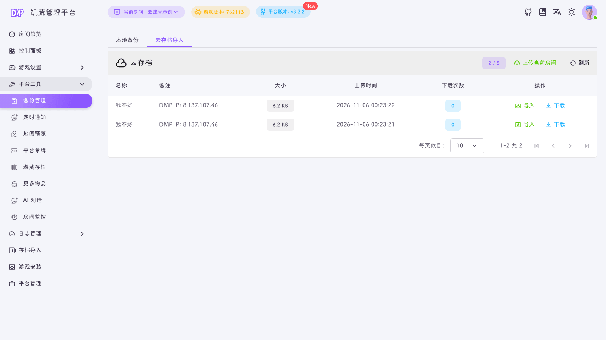
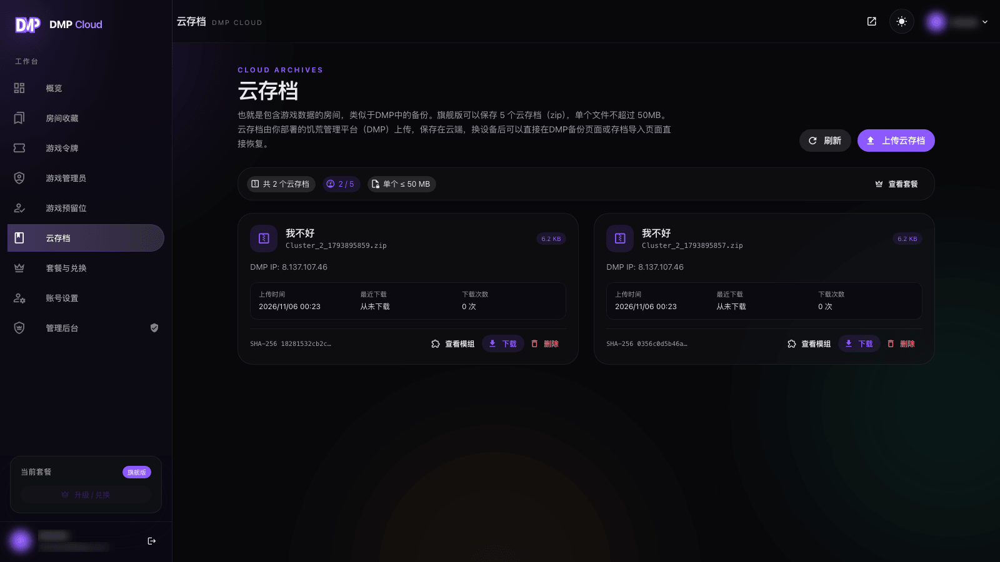

::: warning
该页面内容由AI生成，如有疑问请提交[issue](https://github.com/miracleEverywhere/dst-management-platform-docs)
:::

云存档保存的是**房间存档 zip**，类似于把 DMP 的备份放到云端。它和房间收藏是两套数据：收藏只保存配置快照，云存档保存完整的存档目录。

::: info
云存档是旗舰版专属功能，最多保存 `5` 个 zip，单个不超过 `50MB`。基础版和高级版不能上传新的云存档，但已存在的云存档仍然可以下载和导入。
:::

## 在 DMP 中上传

1. 选中要上传的房间
2. 打开「平台工具 → 备份管理」
3. 切换到「云存档导入」标签
4. 点击「上传当前房间」

DMP 会自动完成这些事：

- 打包当前房间的 `Cluster_N` 存档目录
- 清理日志文件和日志目录
- 每个会话目录只保留最近 `2` 个快照，控制 zip 体积
- 以房间名作为存档名，以平台公网 IP 作为备注
- 上传到云端，并刷新配额

工具栏会显示当前用量，例如 `2 / 5`，以及单包上限 `50MB`。

::: tip
上传时间取决于服务器到云服务的网络速度，存档较大时请耐心等待。
:::

## 在 DMP 中导入

在「云存档导入」列表中点击「导入」：

- 云端存档会下载并导入为**一个新房间**
- 导入成功后自动切换到新房间
- 不会覆盖当前房间
- 需要当前账号拥有创建房间的权限

「下载」则只是把 zip 下载到本地，不会创建房间。

::: warning
云存档包含房间配置与存档文件，但不包含创意工坊的模组文件。导入后如果模组尚未下载，需要先在平台中下载模组，再启动游戏。
:::

## 在云端查看

云端控制台的「云存档」页用于查看、下载和删除：

- 每个存档显示名称、文件名、大小、上传时间、最近下载时间、下载次数和 SHA-256
- 点击「查看模组」可以查看存档中启用的模组
- 点击「下载」可以把 zip 保存到本地
- 点击「删除」会释放一个配额

::: info
云站点**不提供**手动上传 zip 的入口。页面上的「上传云存档」按钮只会显示在 DMP 中上传的步骤，真正的上传必须由 DMP 完成。
:::

## 配额与清理

- 旗舰版最多 `5` 个云存档
- 单个 zip 不超过 `50MB`
- 达到上限后需要先删除不需要的存档
- 删除后配额立即释放
- 套餐变化不会删除已有云存档，但非旗舰版无法继续上传

## 常见问题

**上传提示「云存档超过大小限制」？**

单个 zip 不能超过 `50MB`。可以先清理房间中的旧备份和日志，再重新上传。

**为什么存档里只有最近两个快照？**

DMP 在上传前会裁剪备份会话目录，每个会话只保留最近 `2` 个快照，避免 zip 过大。需要更多历史备份时，请使用本地备份。

**导入云存档会覆盖当前房间吗？**

不会。导入会创建一个新房间，并切换到新房间，当前房间保持不变。
