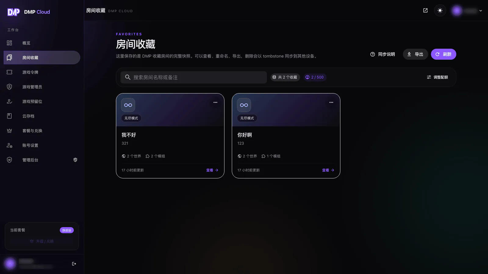
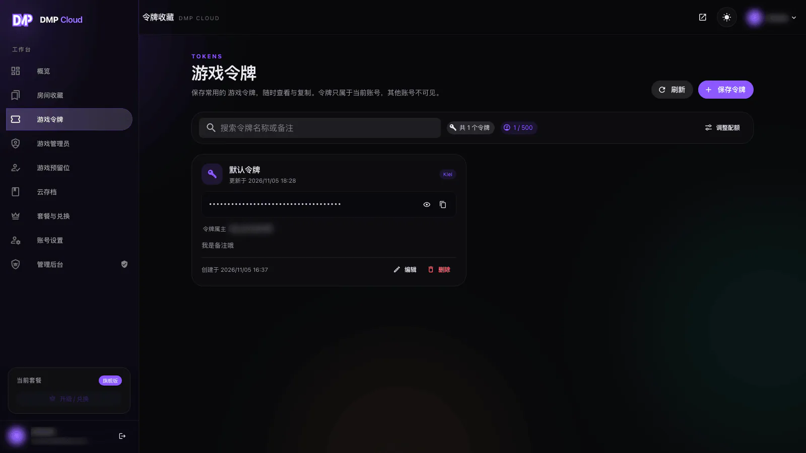
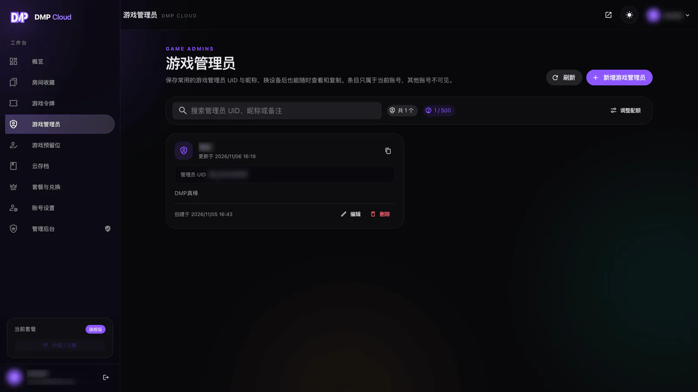
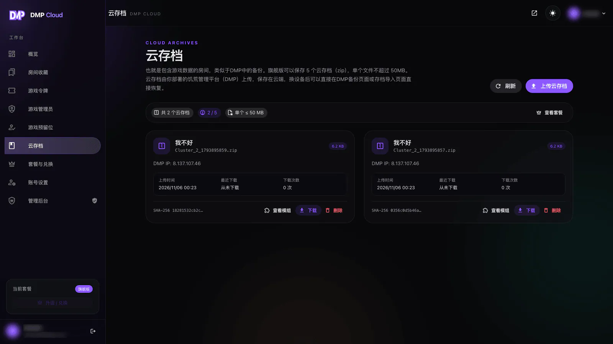
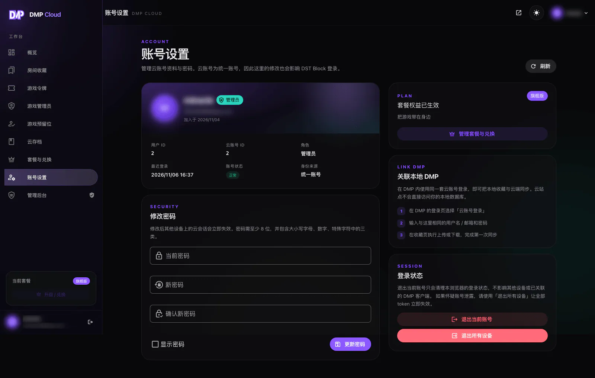

::: warning
该页面内容由AI生成，如有疑问请提交[issue](https://github.com/miracleEverywhere/dst-management-platform-docs)
:::

登录云账号后进入控制台。左侧是云端数据的工作台，DMP 里的绑定状态、配额和同步结果都可以在这里确认。

## 概览

概览页展示当前套餐、各项配额的使用情况、最近的房间收藏和快捷操作。

- 房间收藏、游戏令牌、游戏管理员、游戏预留位、云存档分别统计
- 配额只统计未删除的数据
- 「导出快照」可以把房间收藏导出为 JSON 文件
- 页面底部会提示 DMP 如何接入云账号

## 房间收藏

房间收藏保存的是 **DMP 收藏房间的完整快照**：房间、世界列表与房间设置。

可以执行的操作：

- **查看**：查看快照中的世界、模组与房间设置
- **重命名 / 修改备注**
- **导出**：把快照导出为 JSON
- **删除**：删除会以 tombstone 记录，并在下一次同步时传播到其他设备
- **搜索**：按房间名或备注搜索
- **调整配额**：跳转到套餐页面

::: warning
删除云端收藏会同步删除其他设备上的同一条收藏。删除前请确认其他设备不再需要它。
:::

## 游戏令牌

保存常用的饥荒游戏令牌，换设备后不用再翻找。

- 点击「保存令牌」，填写名称、游戏令牌和备注（可选）
- 令牌值默认隐藏，点击眼睛图标查看，点击复制按钮复制
- 保存时会解析令牌属主，显示在「令牌属主」一栏
- 支持编辑和删除

在 DMP 的房间设置里可以直接选用这里保存的令牌，详见[云端令牌、管理员与预留位](token.md)。

## 游戏管理员与预留位

云端可以保存游戏管理员的 UID / 昵称，以及预留位的 UID / 昵称。

- 新增时填写 UID、昵称和备注（可选）
- 支持编辑、删除和复制 UID
- 游戏预留位的操作方式相同，只是保存到「游戏预留位」列表

在 DMP 的「玩家设置 → 管理员 / 预留位」里可以一次选择多条云端记录添加，详见[云端令牌、管理员与预留位](token.md)。

## 云存档

云存档是旗舰版专属功能，最多保存 `5` 个 zip，单个不超过 `50MB`。

- 云存档由 **DMP 上传**，云站点不提供手动上传 zip 的入口
- 页面上的「上传云存档」按钮会显示 DMP 内的上传步骤
- 可以查看存档包含的模组、下载存档、删除存档
- 每个存档会显示上传时间、最近下载时间、下载次数和 SHA-256 校验值

DMP 内的上传与导入步骤详见[云存档](archive.md)。

## 套餐与兑换

「套餐与兑换」页面用于查看当前套餐、各项配额和兑换记录。

- 基础版默认免费开通，不需要兑换码
- 高级版、旗舰版通过兑换码开通或升级
- 兑换成功后套餐永久生效，已有数据不会因为套餐变化被删除
- 套餐价格与兑换码获取方式以[云账号官网](https://dmp-cloud.miraclesses.top/)为准

::: tip
超出当前套餐配额时，仍然可以查看、下载和删除已有数据，但无法继续新增。删除数据会立即释放配额。
:::

## 账号设置

账号设置页展示：

- 用户名、邮箱、用户 ID、云账号 ID
- 当前套餐、角色、账号状态、身份来源
- 最近登录时间
- 修改密码
- 退出当前账号 / 退出所有设备
- 关联本地 DMP 的步骤说明

修改密码后，其他设备上的云会话会失效。怀疑账号泄露时，使用「退出所有设备」让全部 token 立即失效。

::: tip
云账号是统一账号，这里的用户名、邮箱和密码也会影响 DST Block 的登录。
:::
