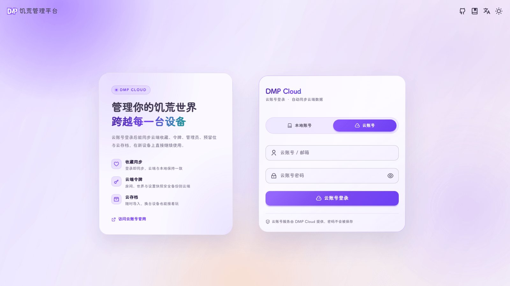
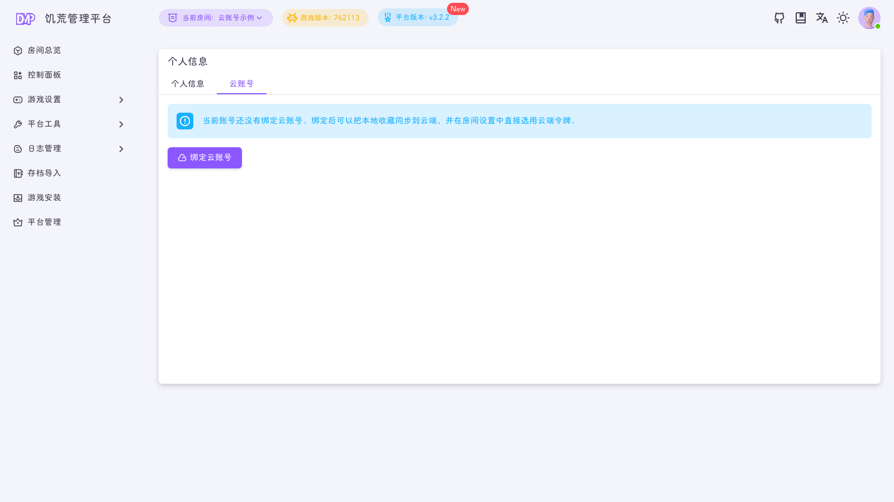
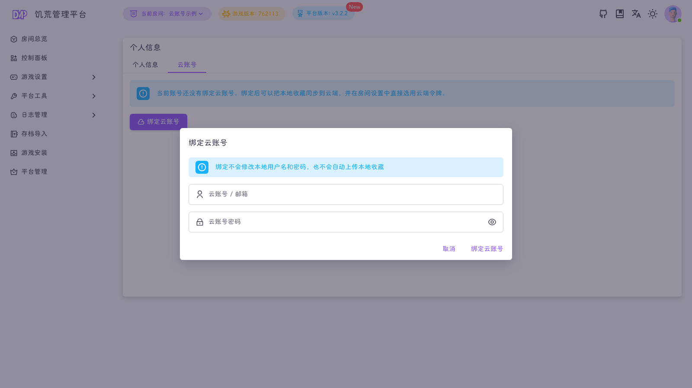
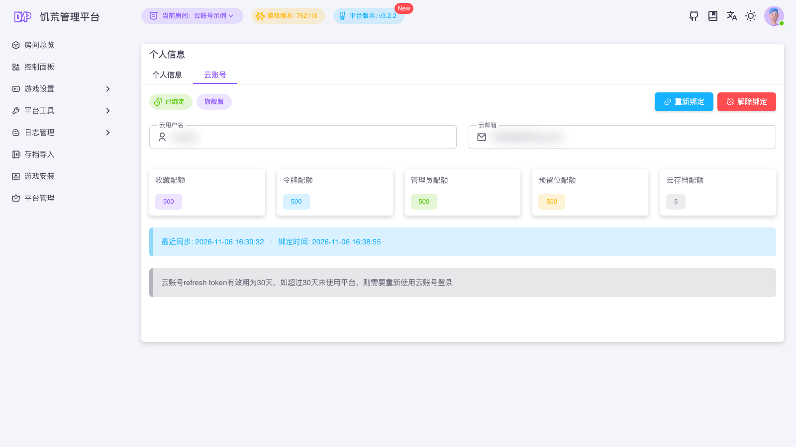

::: warning
该页面内容由AI生成，如有疑问请提交[issue](https://github.com/miracleEverywhere/dst-management-platform-docs)
:::

DMP 提供两种使用云账号的方式：直接用云账号登录，或把云账号绑定到已有的本地账号。两种方式最终都会落到一个**本地用户**上执行操作。

::: info
云账号功能需要 DMP `v3.2.2` 及以上版本。
:::

## 方式一：用云账号登录 DMP

在 DMP 登录页切换到「云账号」标签。

- 账号位置填云用户名或注册邮箱
- 密码填云账号密码
- 登录成功后，DMP 会按云账号找到对应的本地用户，并签发本地登录凭证

### 第一次在全新的 DMP 上登录

如果这台 DMP 还没有任何本地账号，第一次用云账号登录会自动创建一个**本地管理员**：

- 本地用户名使用云账号用户名
- 本地密码与本次输入的云密码相同
- 登录后建议到「个人中心」修改本地密码

### DMP 已有本地账号时

如果 DMP 里已经存在本地账号，直接用云账号登录会提示**未绑定**。这时需要先用本地账号登录，按下面的方式完成绑定。

::: warning
云账号登录不会替代本地账号。DMP 的权限、房间归属和操作记录仍然属于本地用户。
:::

## 方式二：绑定已有本地账号

1. 用本地账号登录 DMP
2. 点击右上角头像，进入「个人中心」
3. 切换到「云账号」标签
4. 点击「绑定云账号」，输入云账号/邮箱和云密码

绑定前，页面会提示当前账号尚未绑定：

| 字段     | 说明                |
|--------|-------------------|
| 云账号 / 邮箱 | 云用户名或注册邮箱         |
| 云账号密码  | 云账号密码，仅用于本次校验，DMP 不会保存 |

绑定**不会**：

- 修改本地用户名和密码
- 自动上传本地收藏
- 删除或覆盖本地数据

## 绑定之后

绑定成功后，「个人中心 → 云账号」会显示云账号信息和配额：

| 项目     | 说明                    |
|--------|-----------------------|
| 云用户名   | 云端账号名                 |
| 云邮箱    | 云端注册邮箱                |
| 套餐     | 基础版 / 高级版 / 旗舰版        |
| 收藏、令牌、管理员、预留位、云存档配额 | 当前套餐的云端上限             |
| 最近同步   | 上一次收藏同步的时间，从未同步时显示「从未同步」 |
| 绑定时间   | 本地账号与云账号建立关联的时间       |

绑定后可以：

- 在「房间收藏」页同步云端收藏
- 在「房间设置」里选择云端令牌
- 在「玩家设置」里选择云端管理员 / 预留位
- 在「备份管理」里上传、下载、导入云存档

## 重新绑定与解除绑定

- **重新绑定**：换成另一个云账号。原云账号的云端数据不会被删除，但本地账号不再与它关联
- **解除绑定**：输入**本地密码或云密码**确认

解除绑定后：

- 本地收藏保留
- 云端收藏不会被删除
- 本地账号不再与云端同步
- 需要重新绑定后才能继续使用云端数据

::: tip
一台 DMP 上，一个本地用户只能绑定一个云账号；一个云账号可以绑定多台 DMP。同一台 DMP 上，一个云账号也只对应一个本地用户。
:::

## 登录状态与有效期

- 云账号的 refresh token 有效期为 `30` 天
- 超过 `30` 天未使用平台，需要重新用云账号登录一次
- 云服务暂时不可用（网络错误、超时或服务端异常）时，云账号登录会尝试回退到本地账号校验；也可以直接使用本地账号登录

## 安全说明

- 云账号密码只在登录/绑定时校验，DMP 不保存云密码
- 云 access / refresh token 由 DMP 后端加密保存在平台数据目录
- 加密密钥位于 `dmp_files/cloud.key`，请和平台数据一起妥善保管
- 浏览器前端不会接触云 token，云 API 只由 DMP 后端调用
