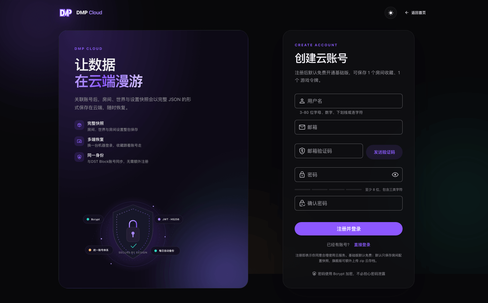
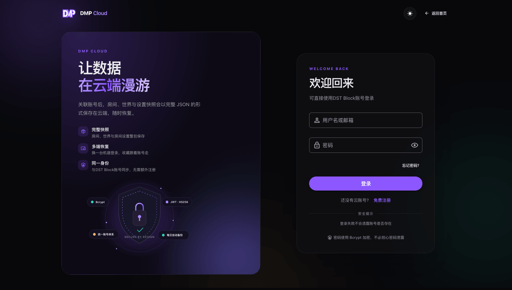
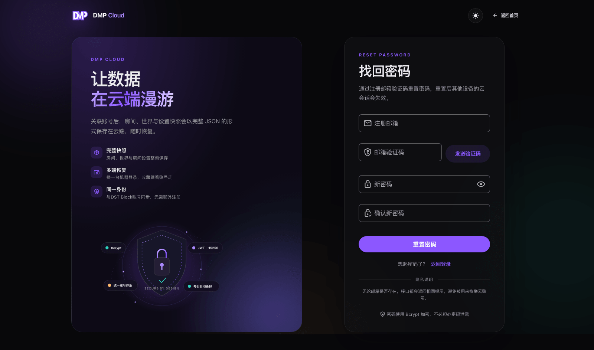

::: warning
该页面内容由AI生成，如有疑问请提交[issue](https://github.com/miracleEverywhere/dst-management-platform-docs)
:::

云账号在 [DMP Cloud](https://dmp-cloud.miraclesses.top/) 注册。注册完成后会直接登录控制台，并默认开通基础版。

## 注册

打开官网，点击「免费注册」，填写用户名、邮箱、邮箱验证码和密码。

各字段要求：

| 字段    | 要求                                              |
|-------|-------------------------------------------------|
| 用户名   | `3` 到 `80` 位，只能包含字母、数字、下划线 `_` 和连字符 `-`           |
| 邮箱    | 用于接收验证码和找回密码，一个邮箱只能注册一个云账号                      |
| 密码    | 至少 `8` 位，最多 `128` 位，需包含小写字母、大写字母、数字、特殊字符中的至少三类 |
| 确认密码  | 与密码一致                                           |

点击「发送验证码」后，查收邮箱中的 `6` 位数字验证码。验证码 `10` 分钟内有效，最多尝试 `5` 次；同一邮箱 `60` 秒内只能发送一次，每小时最多 `10` 次。

::: tip
如果没有收到邮件，先检查垃圾邮件目录，等待 `1` 分钟后再重新发送。
:::

## 登录

- 账号位置可以填**云用户名**，也可以填**注册邮箱**
- 云账号与 DST Block 使用同一套身份数据，可以用同一套用户名/邮箱和密码登录
- 登录失败不会提示账号是否存在，避免被用来枚举账号

## 找回密码

在登录页点击「忘记密码」，通过注册邮箱验证码重置密码。

重置成功后：

- 新密码立即生效
- 其他设备上的云会话会失效，需要重新登录
- 已关联的 DMP 不会被解除绑定，但旧 token 会失效；需要重新用云账号登录（或在个人中心重新绑定）后才能继续同步

::: warning
云账号密码和 DMP 本地账号密码是两套密码。绑定云账号不会修改本地用户名和密码，修改云密码也不会自动修改 DMP 本地密码。
:::

## 账号安全

- 密码使用 `Bcrypt` 存储，云服务只保存哈希
- 登录状态使用独立的 `JWT`，可以在「账号设置」中退出当前账号或退出所有设备
- 不要把账号密码、邮箱验证码发给他人
- 如果怀疑账号泄露，优先使用「退出所有设备」，再修改密码
