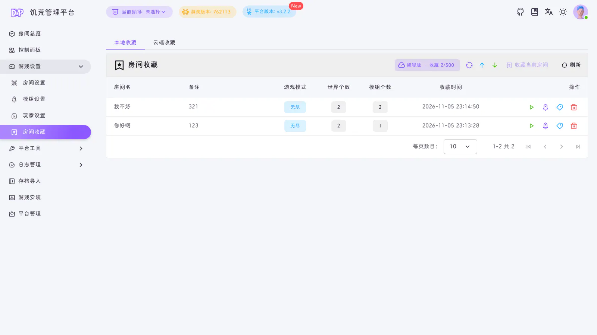
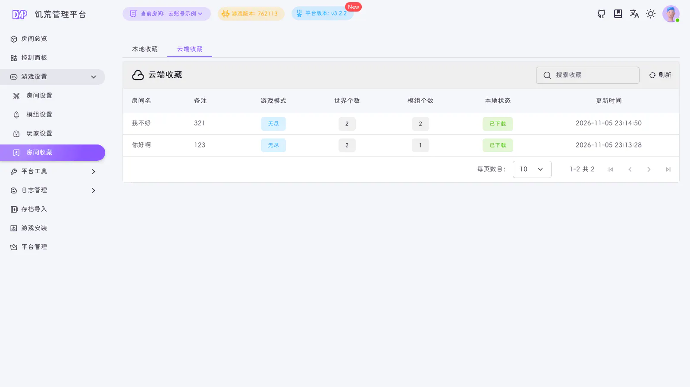
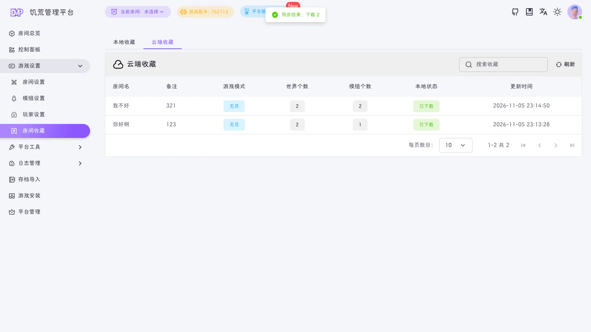

::: warning
该页面内容由AI生成，如有疑问请提交[issue](https://github.com/miracleEverywhere/dst-management-platform-docs)
:::

收藏同步用于把 DMP 的「房间收藏」与云端收藏保持一致。收藏是房间、世界与房间设置的完整 JSON 快照，不包含存档文件。

## 在哪里同步

打开「房间收藏」页面，在「本地收藏」标签的工具栏右侧可以看到三个按钮：

| 按钮 | 名称    | 作用                    |
|----|-------|-----------------------|
| 环形箭头 | 立即同步  | 完整双向同步，默认行为           |
| 向上箭头 | 上传本地收藏 | 只把本地变化推到云端，不拉取云端变化    |
| 向下箭头 | 下载云端收藏 | 只把云端变化拉到本地，不上传本地变化    |

工具栏上的标签会显示当前套餐和云端收藏用量，例如「旗舰版 · 收藏 2/500」。

切换到「云端收藏」标签，可以看到云端保存的收藏和本地状态：

「本地状态」显示这条收藏是否已经下载到本地。

## 三种同步方式

| 数据变化  | 立即同步  | 上传本地收藏 | 下载云端收藏 |
|-------|-------|--------|--------|
| 云端新增  | 本地新建  | 不处理    | 本地新建   |
| 云端更新  | 覆盖本地  | 不处理    | 覆盖本地   |
| 云端删除  | 删除本地  | 不处理    | 删除本地   |
| 本地新增  | 上传云端  | 上传云端   | 不处理    |
| 本地更新  | 上传云端  | 上传云端   | 不处理    |
| 本地删除  | 云端删除  | 云端删除   | 不处理    |

### 立即同步

适合日常使用。云端和本地互相补齐，删除也会双向传播。

### 上传本地收藏

适合「本地是权威版本，只想备份到云端」的场景：

- 云端新增的收藏不会出现在本地
- 云端更新的收藏不会覆盖本地
- 云端删除的收藏不会删除本地
- 本地的新增、修改、删除会上传到云端

### 下载云端收藏

适合「新设备从云端恢复」或「强制以云端为准」的场景：

- 云端收藏会新建或更新到本地
- 云端删除的收藏会删除本地
- 本地有、云端没有的收藏会保留
- 本地的删除不会上传到云端

::: warning
「下载云端收藏」不是把本地完全镜像成云端。本地独有的收藏不会被删除；本地删除也不会传播到云端。
:::

## 合并规则

- 同一条收藏按 `updatedAt` 比较，更新时间较新的一方生效
- 删除使用 tombstone（软删除）记录，并携带更新时间
- 重复执行同步不会产生重复收藏（同步会复用已有的本地/云端映射）
- 时间相同或本地更新的记录不会被云端旧数据覆盖

## 同步结果

同步完成后，右上角会显示本次的变化数量：

统计项包括：

- **上传**：本地新增并上传到云端
- **更新**：两端都有，按更新时间合并
- **删除**：删除传播
- **下载**：云端新增或更新到本地
- **跳过**：快照校验失败、缺少房间名/世界或超过大小限制的记录

没有变化时会提示「没有需要同步的内容」。

## 配额与限制

- 配额只统计未删除的云端收藏，删除后会立即释放
- 配额已满时上传会被阻止，提示「收藏配额已满，请升级套餐后再上传」
- 单条收藏快照最大 `2MB`
- 单次同步最多提交 `1000` 条收藏
- 缺少房间名、世界列表或校验不通过的收藏会被跳过，不会上传

::: tip
云账号登录**不会**自动覆盖本地收藏。第一次使用或换设备后，请到「房间收藏」页手动执行一次同步。
:::

## 常见问题

**同步后出现了重复收藏？**

正常情况下不会。同步会优先使用本地/云端映射，其次用快照指纹去重。如果仍然出现重复，可以先删除其中一条，再执行一次「立即同步」。

**为什么云端显示已删除，本地还在？**

「上传本地收藏」不会拉取云端删除。切换到「立即同步」或「下载云端收藏」后，云端 tombstone 才会删除本地记录。

**删除本地收藏会删除云端吗？**

「立即同步」和「上传本地收藏」会把删除传播到云端；「下载云端收藏」不会。
