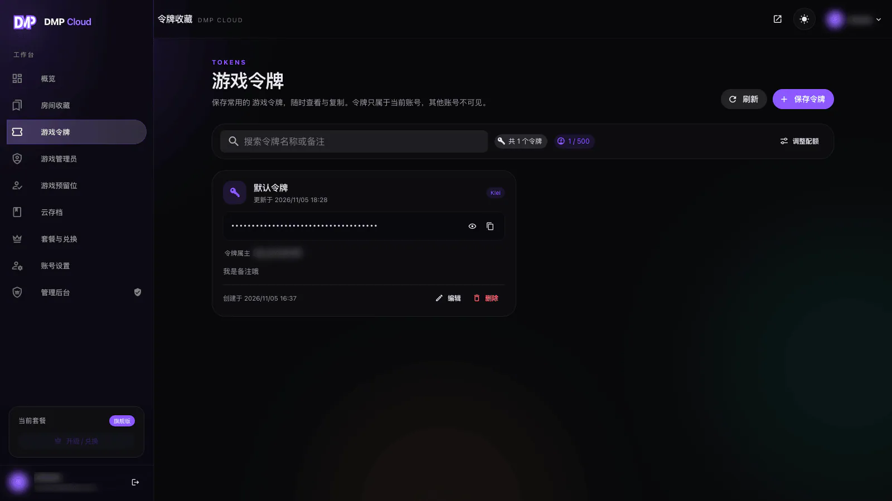
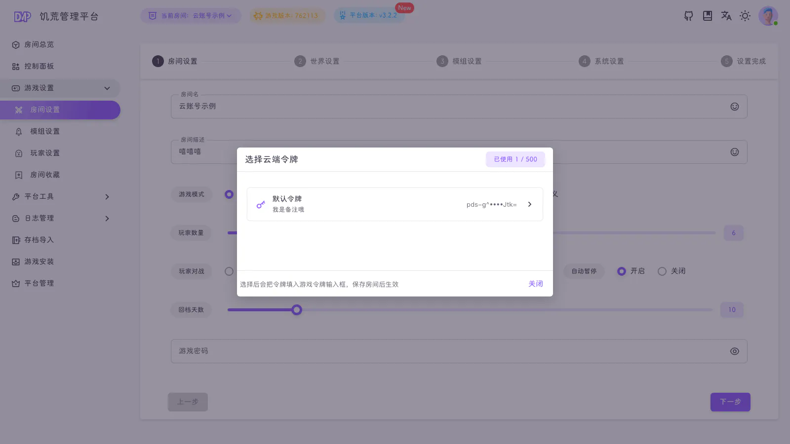
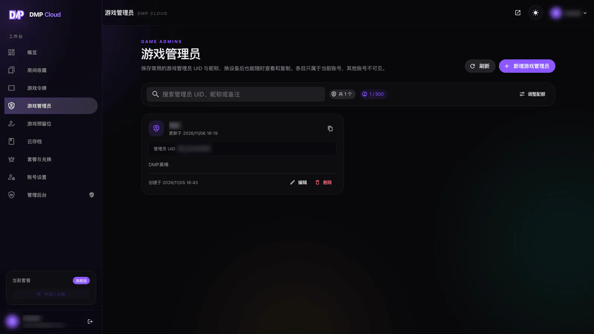
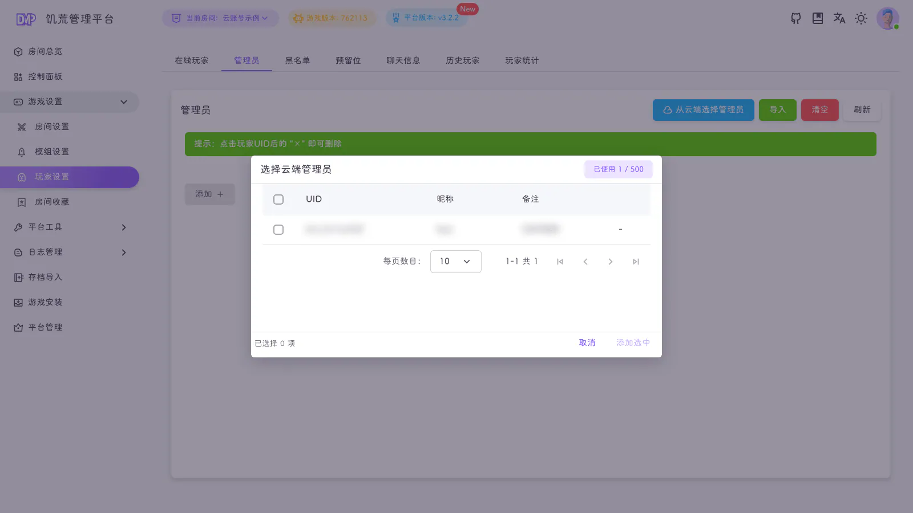
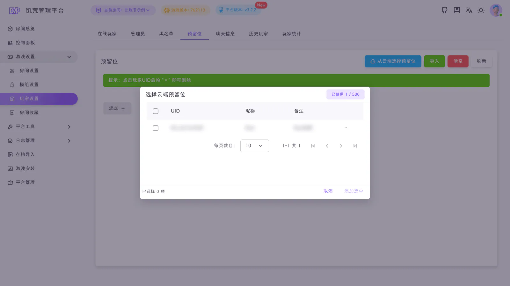

::: warning
该页面内容由AI生成，如有疑问请提交[issue](https://github.com/miracleEverywhere/dst-management-platform-docs)
:::

云账号可以保存常用的游戏令牌、游戏管理员和游戏预留位。绑定云账号后，DMP 里可以直接选用这些数据，不用每次手动复制。

## 云端令牌

### 在云端保存

在云端控制台的「游戏令牌」页点击「保存令牌」，填写名称、游戏令牌和备注：

令牌值默认隐藏，需要时点击眼睛图标查看或复制。保存后可以编辑、删除。

### 在 DMP 中使用

1. 选中一个房间
2. 打开「游戏设置 → 房间设置」
3. 在「游戏令牌」一栏点击「从云端选择」

弹窗会显示当前已使用的令牌数量和配额。选择一条后，令牌会自动填入「游戏令牌」输入框，**保存房间后生效**。

- 云端令牌不会被删除，只是填入当前房间
- 一个房间同一时间只使用一个令牌
- 如果当前账号未绑定云账号，按钮会提示先到个人中心绑定

::: tip
云端的令牌列表只显示打码后的值；选择后会填入房间设置的游戏令牌输入框，保存并重启游戏后生效。
:::

## 云端管理员

### 在云端保存

在云端控制台的「游戏管理员」页新增记录，填写：

- 管理员 UID
- 管理员昵称
- 备注（可选）

### 在 DMP 中使用

1. 选中一个房间
2. 打开「游戏设置 → 玩家设置」
3. 切换到「管理员」标签
4. 点击「从云端选择管理员」

弹窗支持多选：

- 已添加过的 UID 会标记为「已添加」
- 勾选后点击「添加选中」
- 添加后仍需重启游戏才会生效

## 云端预留位

预留位用于白名单中的玩家。操作方式与管理员一致：

1. 在云端控制台的「游戏预留位」页保存 UID、昵称和备注
2. 在 DMP 的「玩家设置 → 预留位」标签点击「从云端选择预留位」

## 配额

游戏令牌、游戏管理员、游戏预留位分别计算配额：

| 套餐  | 每项上限 |
|-----|------|
| 基础版 | 1    |
| 高级版 | 20   |
| 旗舰版 | 500  |

- 配额只统计云端保存的数量，删除后立即释放
- 在 DMP 里「选用」不会额外占用配额，因为数据已经保存在云端
- 达到上限后，需要先删除云端记录或升级套餐

## 常见问题

**在 DMP 里选了令牌，为什么房间还是用旧令牌？**

选择只是把令牌填入表单，需要点击保存房间，并重启游戏后才会生效。

**云端管理员和 DMP 本地管理员是同一回事吗？**

不是。云端保存的是**饥荒游戏内的管理员 UID**，用于写入房间的 `adminlist`；DMP 本地管理员是平台账号，决定谁能登录和管理平台。

**为什么看不到「从云端选择」按钮？**

请先确认当前账号已在「个人中心 → 云账号」完成绑定，并且当前已经选中了一个房间。
