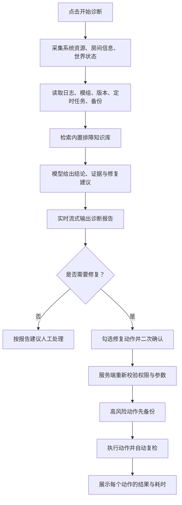

:::info
该功能于`v3.2.3`加入，目前标记为 **Beta**，位于「平台工具」菜单中「AI 对话」的上方
:::

:::important
使用该功能需要**单独**配置一个诊断专用大模型，与 AI 对话的模型配置互不影响，诊断不会回退使用 AI 对话的配置

一次完整诊断会多次调用模型（读取数据 + 生成报告），会产生一定的 token 费用
:::

## 介绍

AI 诊断相当于给房间请了一个值班运维：它会先**只读**地采集服务器的各项数据，再让大模型结合内置的排障知识库给出结论、证据和修复建议，最后由你勾选确认后才会真正执行修复动作

诊断过程中模型可以调用的只读工具：

| 工具 | 采集内容 |
|---|---|
| 系统资源 | CPU、内存、负载、磁盘与运行时长 |
| 房间信息 | 房间配置、世界列表与端口、备份/保活/定时开关服等开关状态 |
| 世界状态 | 单个世界的在线状态、端口与资源占用 |
| 日志 | 游戏日志；系统日志（runtime / access / steam）仅管理员可读 |
| 模组 | 各世界启用的模组列表 |
| 游戏版本 | 平台版本、DST 本地与远端版本、是否正在更新 |
| 定时任务 | 该房间相关的定时备份、定时重启等任务 |
| 备份 | 备份列表与最近一次备份时间 |
| 知识库 | 按关键词检索内置的排障知识库 |

整体流程：

:::tip
诊断本身**只读**，不会修改服务器；唯一的写操作是你勾选并二次确认后的修复动作

游戏处于停止状态时同样可以诊断，世界起不来、启动后立刻退出这类问题正是它的常见用途
:::

:::info
该页面要求饥荒服务端已经安装，未安装时会提示先前往[安装游戏](../install.md)
:::

## 诊断范围

页面顶部可以切换诊断范围（仅管理员可切换）：

| 范围 | 说明 | 谁可以用 |
|---|---|---|
| 当前房间 | 只采集当前选中房间的数据 | 管理员 + 有该房间权限的普通用户 |
| 整个平台 | 采集全部房间、平台设置与系统级数据 | 仅管理员 |

:::warning
选择「当前房间」需要先在页面顶部选中一个房间，未选择房间时无法开始诊断
普通用户默认为「当前房间」，且看不到「整个平台」选项
:::

## 开始诊断

### 异常描述

开始前可以填写一段**异常描述**（选填，最多 1000 字），例如：

> 晚上 9 点后服务器频繁卡顿，玩家集体掉线，重启后世界起不来

这段描述会作为排查线索交给模型，诊断会更有针对性；留空则进行常规全量检查

### 进度

点击 **开始诊断** 后，页面进入诊断视图：

- 顶部显示当前状态（正在创建诊断 / 诊断中 / 正在生成报告 / 诊断完成）与**诊断用时**
- 下方逐条列出模型正在执行的排查步骤，每一步完成后会显示耗时，失败的步骤会显示错误原因
- 诊断期间可以点击 **取消诊断** 终止本次诊断，已生成的进度与报告不再更新
- 诊断在平台后台执行，**离开页面不会取消诊断**，返回本页可以继续查看

:::tip
同一账号、同一房间同一时间只能有一个诊断任务，15 秒内也不能重复发起
:::

## 诊断报告

报告分两部分：先流式输出正文，正文结束后再展示结构化结果

- **正文**：由模型逐字生成的 Markdown 报告，包含总体结论与排查过程
- **结论摘要**：一句话结论 + 严重程度（低 / 中 / 高 / 严重）
- **发现的问题**：每条包含置信度、原因、处理建议和**证据**
- **证据**：可折叠查看，展示来自哪个工具、哪个日志文件，内容是纯文本（已脱敏、过长会截断）
- **参考文档**：命中的内置知识库条目
- **Token 用量**：输入、输出与总计，以及本次使用的模型
- **修复建议**：可执行的动作卡片，见下一节

:::tip
如果流式生成报告失败，平台会退回到用结构化结果拼出的报告，结论依然可以查看
刷新页面后会恢复上一次的诊断结果，需要新的检查结果时点击 **重新诊断**
:::

## 修复建议与执行

报告里的每个修复动作都是一张卡片，卡片上会标注：

- 动作名称与**风险等级**（低 / 中 / 高）
- 是否**可逆**、是否**仅管理员**可执行
- 动作参数（例如要禁用哪个模组、要删除哪个快照）
- 原因与证据

确认无误后勾选动作，点击 **执行选中动作**，会弹出二次确认窗口：

- **普通风险动作**：勾选后确认即可执行
- **高风险动作**：需要手动输入确认文本（删除快照、恢复备份输入**房间名**，更新游戏输入 **UPDATE**）
- 一次只能勾选一个需要输入确认文本的动作
- 选中的**删除存档快照 / 恢复备份**会先自动备份当前存档，再执行

执行过程中服务端会重新校验权限、动作参数与当前状态，执行完会对结果进行**复检**，页面展示每个动作的状态、耗时与复检结论，整体结果分为全部成功、部分成功、执行失败

:::warning
如果某个动作执行失败，后续动作会被跳过；失败后不会自动重试，建议修正后重新诊断
同一房间同一时间只能有一个修复任务
:::

### 动作目录

| 动作 | 风险 | 确认方式 | 权限 | 说明 |
|---|---|---|---|---|
| 启动世界 | 低 | 无需确认 | 房间 / 管理员 | 启动未运行的世界 |
| 重启世界 | 低 | 无需确认 | 房间 / 管理员 | 停止后启动指定世界 |
| 重启房间 | 中 | 普通确认 | 房间 / 管理员 | 停止并启动全部世界 |
| 清理日志 | 低 | 无需确认 | 房间 / 管理员 | 清理游戏日志与聊天日志；系统日志仅管理员 |
| 使用默认游戏令牌 | 中 | 普通确认 | 房间 / 管理员 | 用平台默认游戏令牌替换房间令牌，需重启房间后生效 |
| 禁用模组 | 中 | 普通确认 | 房间 / 管理员 | 从模组配置中禁用指定模组 |
| 启用模组 | 中 | 普通确认 | 房间 / 管理员 | 重新启用指定模组 |
| 删除存档快照 | 高 | 输入房间名 | 房间 / 管理员 | 先备份当前存档，再删除指定快照 |
| 恢复备份 | 高 | 输入房间名 | 房间 / 管理员 | 先备份当前存档，再恢复指定备份 |
| 更新游戏 | 中 | 输入 `UPDATE` | 仅管理员 | 通过 SteamCMD 更新游戏，耗时较长 |

:::info
以下操作**不会**交给 AI 执行：

- 预下载模组、修改端口：涉及文件地址解析与端口变更，请在[模组设置](../setting/mod.md)、[房间设置](../setting/room.md)中人工操作
- 重置世界、删除房间：不可逆的破坏性操作，AI 永远不会执行
:::

## 模型设置

「模型设置」标签页**仅管理员可见**，诊断只使用这里的专用配置：

- **Chat Base URL**：兼容 `OpenAI Chat Completions API` 的服务地址
- **API Key**：选填，服务不需要鉴权时可留空
- **模型名称**：例如 `deepseek-v4-flash`

:::tip
诊断固定使用 `temperature 0.2`、`max_tokens 4096`、单次请求 90 秒超时，不随配置变化
这些都是为了稳定输出而固定的参数，页面上不能修改
:::

:::warning
诊断配置与 AI 对话的配置**完全独立**：未填写时诊断会直接提示「尚未配置可用的大模型」，不会回退使用 AI 对话的模型

点击 **清除诊断配置** 后诊断将无法运行，直到重新配置
:::

## 历史记录

「历史记录」标签页保存了历次诊断：

- 支持按**诊断范围**与**诊断状态**（诊断中 / 已完成 / 失败 / 已取消 / 已中断）筛选
- 列表展示时间、范围、房间、状态、严重程度、结论摘要、现象描述与修复动作数量
- 点击 **查看** 可打开诊断详情：现象描述、诊断报告、证据、修复动作及其执行结果
- 普通用户只能看到自己有权限的房间记录，平台级记录仅管理员可见

## 权限与隐私

不同角色的能力差异：

| 能力 | 普通用户 | 管理员 |
|---|---|---|
| 诊断当前房间 | 仅限有权限的房间 | 任意房间 |
| 诊断整个平台 | ❌ | ✅ |
| 读取系统日志 | ❌（只能读游戏日志） | ✅ |
| 修改诊断模型设置 | ❌ | ✅ |
| 执行「更新游戏」动作 | ❌ | ✅ |
| 查看历史记录 | 自己有权房间的记录 | 全部记录 |

为了让诊断安全可用，平台做了这些限制：

- 诊断只读取数据，工具全部是只读的；唯一的写操作是你授权后的修复动作
- AI 不能生成 shell 命令，只能返回白名单中的动作 ID；动作执行前服务端会重新校验权限、参数、证据与当前状态
- **不会**发送给模型：房间令牌、房间密码、ClusterKey、`cluster_token.txt`、AI API Key、Webhook 地址、玩家聊天日志
- 日志内容会脱敏并截断，证据中会标注是否被截断
- 所有已执行的动作都会写入审计表，可在历史详情中查看

## 常见问题

| 提示 | 原因与处理 |
|---|---|
| 尚未配置可用的大模型 | 到「模型设置」填写 Base URL、API Key 与模型名；诊断不会使用 AI 对话的配置 |
| 诊断大模型配置不完整或不合法 | 检查 Base URL 与模型名是否填写正确 |
| 诊断任务正在进行中 | 同一账号、同一房间同一时间只能跑一个诊断，等本次结束或取消后再试 |
| 该房间已有修复任务 | 修复动作正在执行，等它结束后再执行新的动作 |
| 与服务器的实时连接已中断 | 点击 **重新连接** 即可恢复，诊断仍在后台执行，不会被取消 |
| 诊断已过期 / 诊断记录不存在 | 会话保留 15 分钟，超时后请重新诊断，或到「历史记录」查看结果 |
| 诊断未完成时执行修复 | 报告尚未生成完毕，等诊断结束后再执行修复动作 |
| 权限不足 | 普通用户只能诊断自己有权限的房间，平台级诊断与系统日志仅管理员可用 |
