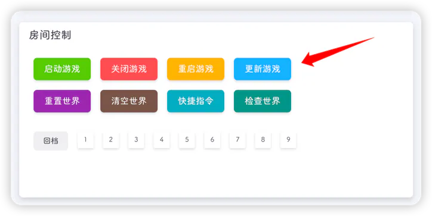
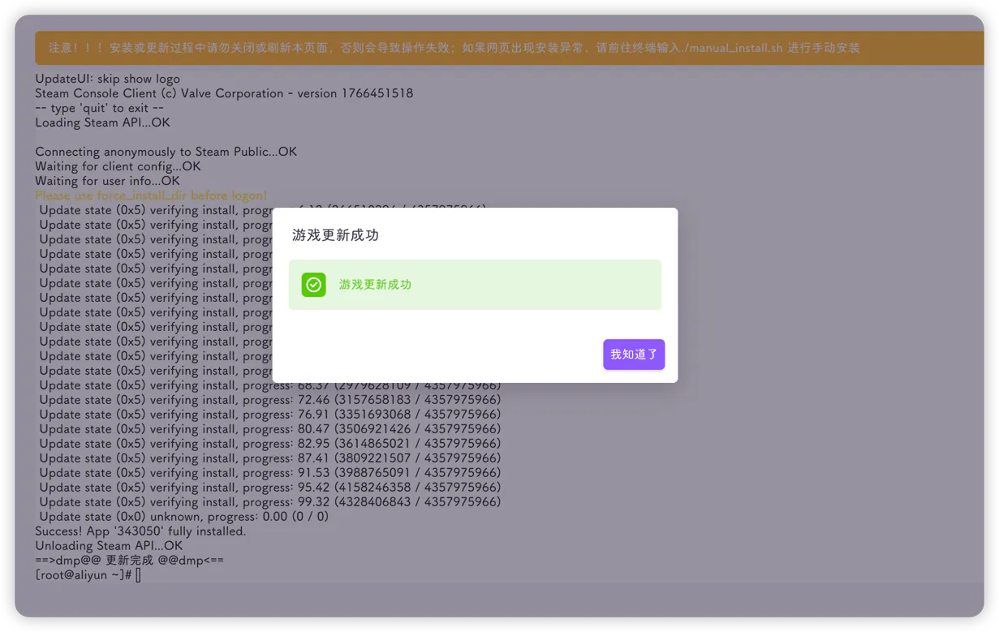
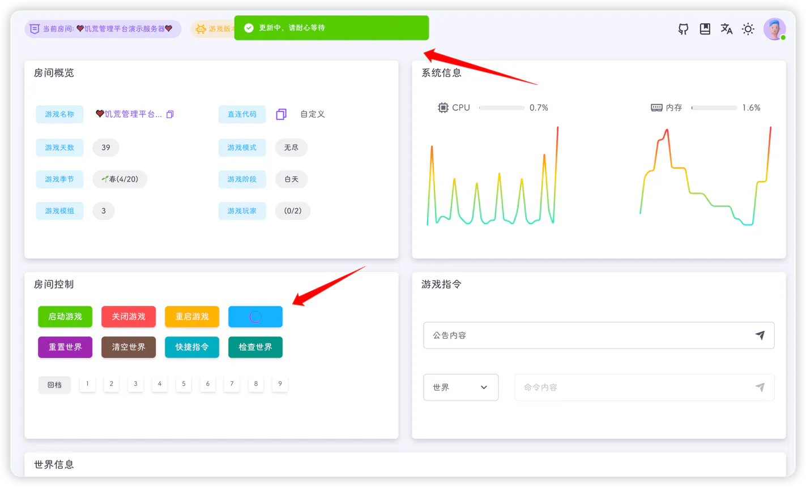
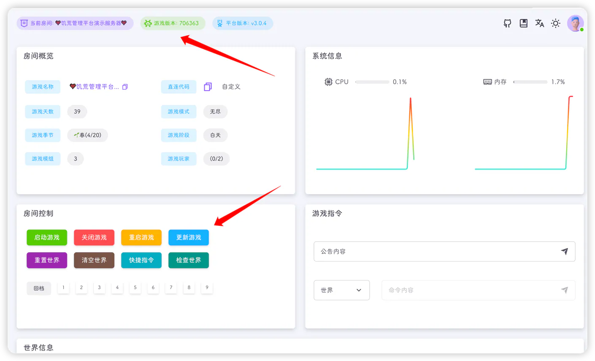

::: info
游戏也是需要更新的，不更新游戏是搜不到房间的
:::

当你发现游戏版本变黄了后，那就说明饥荒需要更新了

你可以点击控制面板的更新游戏按钮

更新方式有两种，分别是前台更新与后台更新

- 前台更新：会跳转至游戏安装页面，点击更新游戏即可，页面会实时显示更新进度，更新完成后会有相应的提示(`dmp>=v3.0.5`)

- 后台更新：指平台进行静默更新，更新时按钮会进入Loading状态，更新完成后恢复，手动刷新页面即可

::: tip
两种方式最终都是在平台后台执行 SteamCMD，任务一旦开始就不会因为刷新或关闭网页而中断
更新期间重新打开「安装游戏」页面会自动接回实时日志；如果任务是由后台更新、定时更新或 AI 诊断修复触发的，页面只会提示已有任务正在进行
:::

