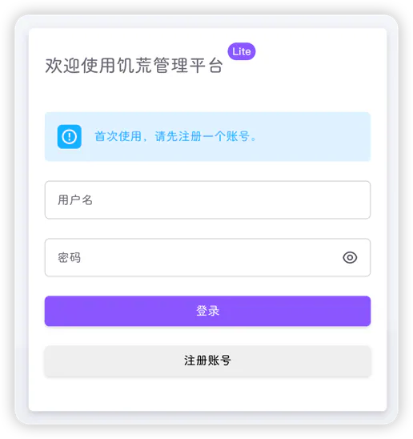
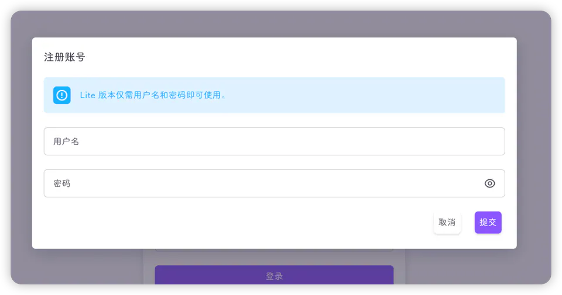
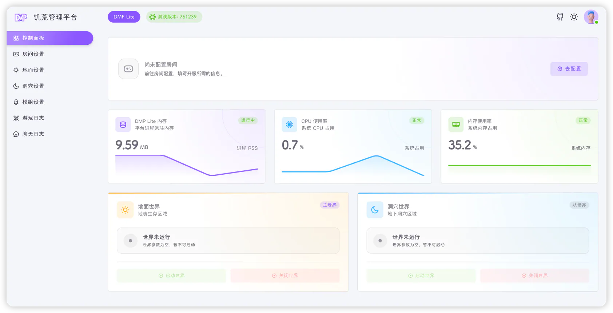

## 注册账号

Lite 采用**单账号**设计：整个平台只有一个用户，首次使用时注册，注册完成后不再提供注册入口，也没有用户管理页面。

浏览器打开 `http://服务器IP:9999`（端口以 `PORT` 为准），未登录时会跳转到登录页 `/login`：



首次访问时，卡片上会出现"首次使用，请先注册一个账号。"的提示，点击 **注册账号**：



- 只需填写**用户名**和**密码**，没有邮箱、昵称等字段
- 用户名不能为空，密码不能为空，密码使用 bcrypt 加密后保存在 `dmp-lite.sdb`
- 注册成功后，注册按钮会消失，之后只能用这个账号登录
- 想更换账号只能清空数据库重来，见[常见问题](./faq.md#忘记密码怎么办)

## 登录

输入用户名和密码，点击 **登录**。登录成功后：

1. 后端签发 JWT（有效期 3 天，剩余不足一半时会自动续期）
2. 前端拉取菜单，固定为 7 个页面
3. 跳转到 [控制面板](./dashboard.md)



## 界面构成

- **左侧菜单**：控制面板、房间设置、地面设置、洞穴设置、模组设置、游戏日志、聊天日志
- **顶部游戏版本**：显示当前本地服务端版本，颜色含义见下表
- **右上角**：明暗主题切换、账号菜单（退出平台）

| 版本标签颜色 | 含义                                                |
|--------|---------------------------------------------------|
| 绿色     | 本地版本与官方最新版本一致                                     |
| 黄色     | 本地版本落后于最新版本，可执行"更新游戏"                             |
| 红色     | 本地版本为 `0`，通常表示未安装 `dst/` 或 `dst/version.txt` 读取失败 |

把鼠标悬停在版本标签上，可以同时看到**当前版本**与**最新版本**。

## 首次开服顺序

Lite 没有"安装向导"，第一次开服按下面顺序操作即可。

### 1. 配置房间

进入 **房间设置**，填写房间名、游戏令牌等必填项并保存，详细说明见[房间设置](./room.md)。

::: tip
如果还没申请令牌，可以先用页面上的 **默认令牌** 按钮填入测试令牌，但**不要长期使用**。
:::

### 2. 配置世界

进入 **地面设置** 与 **洞穴设置**，确认端口后，在代码编辑器中填写 `leveldataoverride.lua` 并保存，详细说明见[世界设置](./world.md)。

::: warning
`leveldataoverride.lua` 为空时，[控制面板](./dashboard.md) 上的 **启动世界** 按钮是灰色的，世界无法启动。
:::

如果暂时没有世界配置，可以从已有存档中复制：

```text
~/.klei/DoNotStarveTogether/Cluster_1/Master/leveldataoverride.lua
~/.klei/DoNotStarveTogether/Cluster_1/Caves/leveldataoverride.lua
```

也可以从完整版 DMP 中同一房间的对应文件复制过来。

### 3. 启动世界

回到 **控制面板**：

1. 先点击地面世界的 **启动世界**
2. 等地面世界状态变为"世界运行中"后，再启动洞穴世界

::: tip
地面是主世界（`is_master = true`），洞穴需要连接主世界。先启动主世界可以避免洞穴启动失败。
:::

游戏首次启动需要生成世界，可能需要几十秒到几分钟；期间控制面板的世界状态由 `screen` 会话是否存在决定，请耐心等待。

### 4. 放行端口并进入游戏

在云服务器安全组中放行网页端口与游戏端口（见[安装与启动](./install.md#放行端口)），然后：

- 在游戏内通过 **浏览游戏** 搜索房间名
- 或把控制面板房间卡片上的 **直连地址** 复制给玩家，在游戏控制台（`~` 键）中粘贴执行

直连地址由后台拼接，格式为：

```lua
c_connect('公网IP', 11001, '房间密码')
```

其中 `11001` 是地面世界的直连端口（默认值），没有设置房间密码时不会带第三个参数。

::: tip
直连地址中的 IP 是后台定时获取的公网 IP。如果刚启动时显示为空或明显不对，稍等片刻刷新页面；仍不正确时，可以在游戏中手动执行 `c_connect('你的公网IP', 11001)`。
:::

## 下一步

- 日常启停、更新游戏：[控制面板](./dashboard.md)
- 修改房间参数：[房间设置](./room.md)
- 添加模组：[模组设置](./mod.md)
