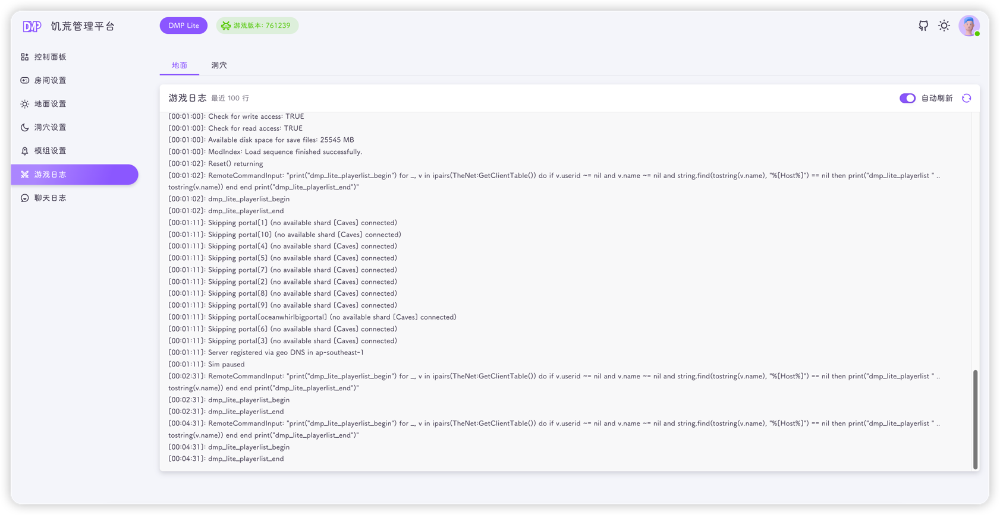

Lite 提供两个日志页面：**游戏日志** 与 **聊天日志**，都只展示当前文件的最新内容，不保存历史日志。

::: info
世界尚未配置时，两个页面都会提示"世界尚未配置，暂时无法读取日志"，先在[世界设置](./world.md)中完成配置即可。
:::

## 游戏日志

进入 **游戏日志**，页面顶部可切换地面 / 洞穴：



- 默认显示 **地面** 世界，点击 **洞穴** 切换到洞穴世界日志
- 对应文件：

```text
~/.klei/DoNotStarveTogether/Cluster_1/Master/server_log.txt
~/.klei/DoNotStarveTogether/Cluster_1/Caves/server_log.txt
```

- 只显示文件末尾 **最近 100 行**，行数由服务端固定，页面上不能调整
- 默认开启 **自动刷新**，每 2 秒拉取一次
- 日志会跟随滚动到底部；向上滚动查看历史内容时会暂停跟随，右下角出现 **继续跟随** 按钮，点击后回到最新日志
- 点击右上角刷新图标可手动拉取一次

::: tip
排查世界启动失败、模组加载失败等问题时，优先看这里。日志中的报错通常能直接指出缺失的依赖或错误的 Lua 配置。
:::

## 聊天日志

**聊天日志** 页面展示游戏内玩家聊天记录

- 对应文件：

```text
~/.klei/DoNotStarveTogether/Cluster_1/Master/server_chat_log.txt
~/.klei/DoNotStarveTogether/Cluster_1/Caves/server_chat_log.txt
```

- 聊天日志由主世界写入；主世界文件不存在或为空时，平台会自动回退读取洞穴的聊天日志
- 同样只显示最近 100 行，支持自动刷新、手动刷新与"继续跟随"

::: info
饥荒只在玩家发送聊天消息时写入聊天日志。如果世界刚启动还没有人说话，页面会显示"暂无日志"。
:::

## 日志文件位置

| 日志     | 位置                                                                 |
|--------|--------------------------------------------------------------------|
| 地面游戏日志 | `~/.klei/DoNotStarveTogether/Cluster_1/Master/server_log.txt`      |
| 洞穴游戏日志 | `~/.klei/DoNotStarveTogether/Cluster_1/Caves/server_log.txt`       |
| 地面聊天日志 | `~/.klei/DoNotStarveTogether/Cluster_1/Master/server_chat_log.txt` |
| 洞穴聊天日志 | `~/.klei/DoNotStarveTogether/Cluster_1/Caves/server_chat_log.txt`  |
| 平台运行日志 | `<Lite 工作目录>/logs/dmp-lite.log`                                    |

平台日志记录 Lite 自身启动、接口、定时任务等信息，排查"平台打不开""接口报错"时使用：

```bash
tail -f /root/dmp-lite/logs/dmp-lite.log
```

::: warning
`~` 指的是**运行 Lite 的用户**的 Home 目录。以 `root` 运行时是 `/root/.klei/...`，不要到普通用户目录下找。
:::

## 关于 100 行限制

Lite 的日志接口固定只读取文件末尾 100 行，并且单次最多读取 1MB，目的是控制内存占用。

如果需要更早的日志：

- 直接在服务器上查看文件：

```bash
tail -n 500 ~/.klei/DoNotStarveTogether/Cluster_1/Master/server_log.txt
```

- 或者使用 `grep` 搜索关键字：

```bash
grep -i "error" ~/.klei/DoNotStarveTogether/Cluster_1/Master/server_log.txt
```

游戏运行时间越长，`server_log.txt` 会越大。需要清理时，请先关闭世界，备份后再清空文件。
