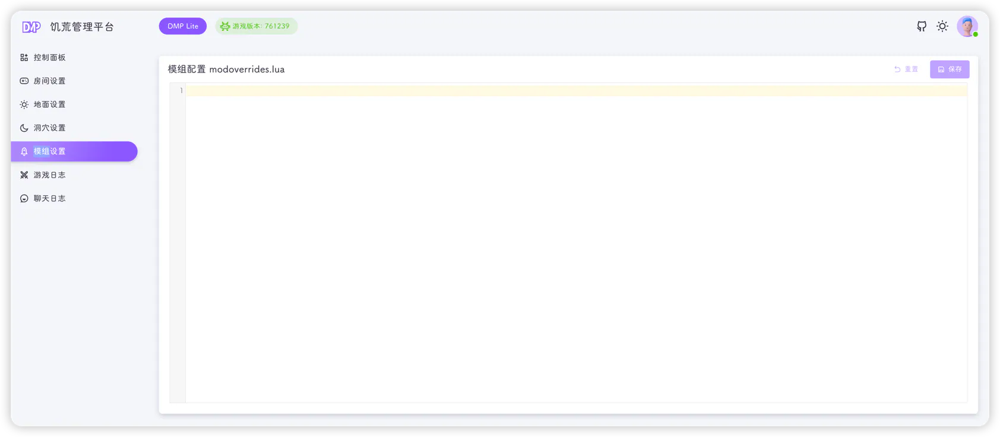

Lite 把地面与洞穴的模组配置合并为一个页面，保存时会**同时写入两个世界**，保证主从世界模组一致。



## 编辑器

页面中的代码编辑器对应：

```text
~/.klei/DoNotStarveTogether/Cluster_1/Master/modoverrides.lua
~/.klei/DoNotStarveTogether/Cluster_1/Caves/modoverrides.lua
```

一个典型的模组配置如下：

```lua
return {
  ["workshop-378160973"] = {
    enabled = true,
    configuration_options = {}
  },
  ["workshop-1207269058"] = {
    enabled = true,
    configuration_options = {
      ["language"] = "zh",
    }
  }
}
```

- 编辑器带 Lua 语法高亮
- **保存** 只有在内容发生变化时才可点击；保存期间按钮显示 loading
- **重置** 放弃未保存的修改，恢复为最近一次保存的内容

## 保存时做了什么

点击 **保存** 后，后端会：

1. 把编辑器内容写入地面和洞穴两个世界的 `modoverrides.lua`
2. 从内容中提取所有 `["workshop-数字"]` 形式的键
3. 生成 `dst/mods/dedicated_server_mods_setup.lua`，每个模组一行：

```lua
ServerModSetup("378160973")
ServerModSetup("1207269058")
```

4. 更新 `dmp-lite.sdb` 中保存的模组配置

::: tip
控制面板房间卡片上的"模组数量"统计的就是 `["workshop-数字"]` 的条目数，与这里保存的内容一致。
:::

## 生效方式

保存只会写文件，**不会立即加载模组**：

1. 保存配置
2. 在[控制面板](./dashboard.md)关闭地面与洞穴世界
3. 重新启动世界

首次启用某个模组时，游戏需要通过 Steam 创意工坊下载模组文件，启动会明显变慢；下载失败时模组不会生效，可在[游戏日志](./logs.md)中搜索 `workshop` 排查。

::: warning
- 请保持 Lua 语法正确，格式错误会导致世界启动失败
- 关闭某个模组时，建议同时删除对应的 `["workshop-xxx"]` 配置块，避免残留配置
- 如果清空整个编辑器并保存，会清空两个世界的 `modoverrides.lua` 和模组订阅列表
:::

## 添加模组的步骤

1. 在 Steam 创意工坊找到模组，记录其 ID（`workshop-` 后面的数字）
2. 在编辑器里添加对应的配置块
3. 保存
4. 重启地面与洞穴世界
5. 在游戏内或日志中确认模组已加载

::: info
Lite 不提供模组搜索、订阅、配置项可视化等能力，所有内容都需要手写。需要这些功能请使用完整版 DMP 的[模组设置](../docs/setting/mod.md)。
:::
