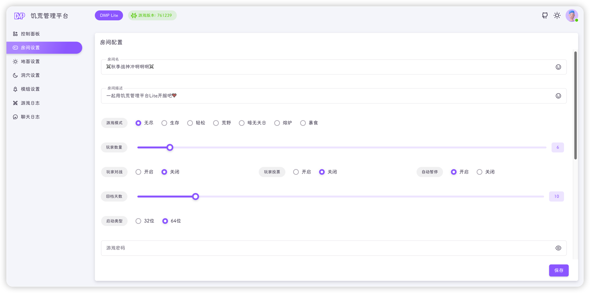

Lite 固定只有一个房间（`Cluster_1`），房间设置页面的内容在保存后会写入：

```text
~/.klei/DoNotStarveTogether/Cluster_1/cluster.ini
~/.klei/DoNotStarveTogether/Cluster_1/cluster_token.txt
~/.klei/DoNotStarveTogether/Cluster_1/whitelist.txt
~/.klei/DoNotStarveTogether/Cluster_1/adminlist.txt
~/.klei/DoNotStarveTogether/Cluster_1/blocklist.txt
```



## 字段说明

加粗为必填项，未填写时无法保存。

| 字段         | 必填 | 对应配置                               | 说明                            |
|------------|----|------------------------------------|-------------------------------|
| **房间名**    | 是  | `cluster_name`                     | 游戏内搜索房间时使用的名称；右侧按钮可插入饥荒表情     |
| 房间描述       | 否  | `cluster_description`              | 游戏房间详情中显示的文字，按 `Tab` 可查看      |
| **游戏模式**   | 是  | `game_mode`                        | 无尽、生存、轻松、荒野、暗无天日、熔炉、暴食；新手推荐无尽 |
| 玩家数量       | 否  | `max_players`                      | 滑块范围 `1`～`64`                 |
| 玩家对战       | 否  | `pvp`                              | 玩家之间是否可以互相攻击                  |
| 玩家投票       | 否  | `vote_enabled`、`vote_kick_enabled` | 玩家能否在游戏内发起投票回档、重置、踢人          |
| 自动暂停       | 否  | `pause_when_empty`                 | 没有玩家时是否暂停游戏时间                 |
| 回档天数       | 否  | `max_snapshots`                    | 快照数量上限，范围 `1`～`64`            |
| **启动类型**   | 是  | -                                  | 游戏的启动类型，分32位和64位              |
| 游戏密码       | 否  | `cluster_password`                 | 留空表示无密码                       |
| **游戏令牌**   | 是  | `cluster_token.txt`                | 科雷官网申请的服务器令牌                  |
| **主世界IP**  | 是  | `master_ip`                        | 单机部署保持 `127.0.0.1` 即可         |
| **主世界端口**  | 是  | `master_port`                      | 主从世界通信端口，单机部署无需修改             |
| **世界认证密码** | 是  | `cluster_key`                      | 主从世界的连接密码，页面会自动生成随机值          |

::: tip
"主世界IP"和"主世界端口"只有在多台服务器分别开地面 / 洞穴时才需要修改。Lite 就是单机单房间，保持默认即可。
:::

::: warning
"世界认证密码"相当于集群的通信密钥，不要设置成简单密码，也不要随意泄露。
:::

## 玩家名单

预留位、管理员、黑名单使用标签输入框：

- 输入玩家 UID 后按 **回车** 生成一个标签
- 也支持用英文逗号、中文逗号或空格分隔多个 UID
- 点击标签右侧的 `×` 可删除，清空输入框可一次移除全部

保存时会转换为**一行一个 UID** 的文本：

| 页面字段 | 写入文件 | 额外说明 |
| --- | --- | --- |
| 预留位 | `whitelist.txt` | 同时把行数写入 `cluster.ini` 的 `whitelist_slots` |
| 管理员 | `adminlist.txt` | 游戏内管理员 |
| 黑名单 | `blocklist.txt` | 禁止进入房间的玩家 |

::: tip
留空表示不限制。玩家 UID 可以在游戏内或通过完整版 DMP 的玩家页面查询。
:::

## 游戏令牌

- 点击 **创建令牌** 会打开科雷账号页面（`https://accounts.klei.com`），登录后申请令牌
- 点击 **默认令牌** 会填入一个内置的公共测试令牌
- 令牌输入框右侧的眼睛图标可切换明文 / 密文显示

::: danger
默认令牌是公开的测试令牌，可能随时失效，也可能被其他人使用。正式开服请务必使用自己申请的令牌。
:::

令牌申请步骤见[令牌申请](../quick-start/token.md)。

## 表情

房间名与房间描述右侧都有表情按钮，点击后打开表情面板：

- **插入** 模式：把选中的表情插入到当前光标位置
- **复制** 模式：把表情复制到剪贴板，可粘贴到其他地方

## 保存

点击页面右下角 **保存**：

1. 前端校验房间名、令牌、主世界 IP、主世界端口、世界认证密码不能为空
2. 把三个名单从标签数组转成换行分隔的字符串
3. 把完整房间配置提交给后端
4. 后端校验必填项并写入上面的配置文件，同时更新 `dmp-lite.sdb`

保存成功后右下角会提示"更新成功"。

::: warning
房间配置是**整体替换**，不是增量更新。页面加载时会读取当前配置，在页面上修改后保存即可。
:::

::: info
房间设置只写入房间级配置。世界级配置（端口、`leveldataoverride.lua`）请到[世界设置](./world.md)中修改。
:::

::: tip
保存房间设置不会自动重启游戏。修改房间名、密码、人数等配置后，需要到[控制面板](./dashboard.md)关闭并重新启动地面、洞穴世界才会生效。
:::
