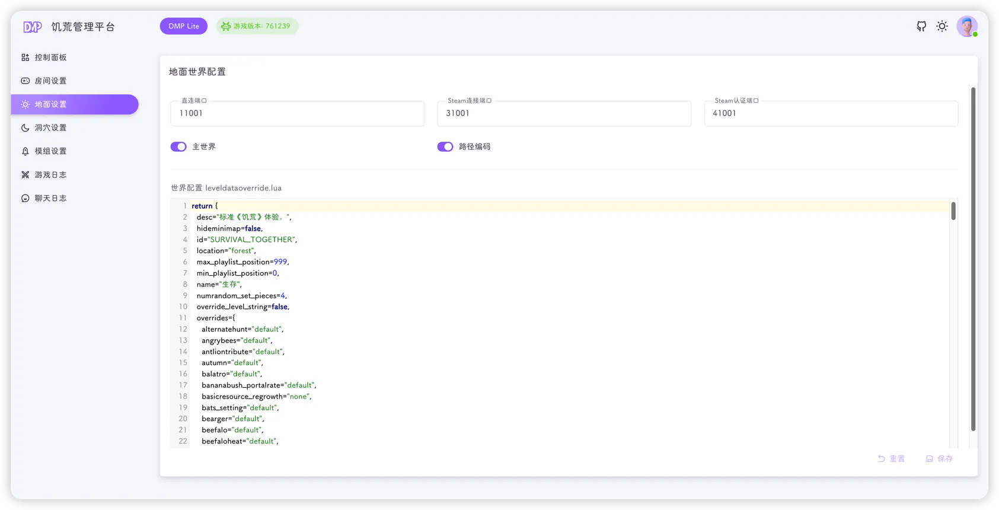

Lite 固定两个世界：**地面（Master）** 与 **洞穴（Caves）**，分别对应左侧菜单的"地面设置"和"洞穴设置"。两个页面结构完全一样，只是默认值不同。



## 端口

| 字段        | 对应 `server.ini`               | 说明                                       |
|-----------|-------------------------------|------------------------------------------|
| 直连端口      | `[NETWORK] server_port`       | 玩家直连使用的 UDP 端口，地面默认 `11001`，洞穴默认 `11002` |
| Steam连接端口 | `[STEAM] master_server_port`  | 如无特殊用途不要修改                               |
| Steam认证端口 | `[STEAM] authentication_port` | 如无特殊用途不要修改                               |

这三个端口在页面上是**只读**的，Lite 不提供修改入口。端口确实需要调整时，请参考[修改端口](#修改端口)。

::: tip
Lite 默认使用 `11001`（地面）和 `11002`（洞穴）。云服务器安全组需要放行这两个 UDP 端口，否则玩家无法直连。
:::

## 开关

| 开关   | 对应字段                         | 说明                      |
|------|------------------------------|-------------------------|
| 主世界  | `[SHARD] is_master`          | 该世界是否为主世界；地面默认开启，洞穴默认关闭 |
| 路径编码 | `[ACCOUNT] encode_user_path` | 用户存档路径编码，建议保持开启         |

::: danger
一个集群只能有一个主世界。除非你非常清楚自己在做什么，否则不要修改"主世界"开关，错误的组合会导致洞穴无法连接、玩家数据异常。
:::

## 世界配置 leveldataoverride.lua

页面下方的代码编辑器用于编辑该世界的 `leveldataoverride.lua`（世界生成与生物、资源等参数），带 Lua 语法高亮。

- 编辑器内容为空时，保存只更新平台数据库，**不会写入** `leveldataoverride.lua` 和 `server.ini`
- 内容为空的世界在[控制面板](./dashboard.md)中**无法启动**，会提示"世界参数为空，暂不可启动"
- 修改后点击 **保存**，写入：

```text
~/.klei/DoNotStarveTogether/Cluster_1/Master/server.ini
~/.klei/DoNotStarveTogether/Cluster_1/Master/leveldataoverride.lua
```

洞穴则写入 `Caves` 目录。

::: tip
Lite 没有可视化世界配置，需要你直接提供 `leveldataoverride.lua` 内容。可以从以下位置复制现成的配置：

- 已有存档：`~/.klei/DoNotStarveTogether/Cluster_1/<Master 或 Caves>/leveldataoverride.lua`
- 完整版 DMP：在"世界设置"中保存后生成的同名文件
:::

::: warning
请保持 Lua 语法正确。格式错误会导致世界启动失败，具体报错可在[游戏日志](./logs.md)中查看。
:::

## 保存与重置

- **保存**：提交当前端口、开关与编辑器内容，后端校验世界 ID 与三个端口非 0 后写文件、更新数据库
- **重置**：放弃未保存的修改，把编辑器和两个开关恢复为上次保存的值
- 没有修改时，两个按钮都是禁用状态

保存成功后右下角提示"更新成功"。

::: tip
世界配置在游戏启动时读取。保存后需要到[控制面板](./dashboard.md)关闭并重新启动对应世界才会生效。
:::

::: info
世界名（`Master` / `Caves`）由 Lite 固定，页面上不能修改。重命名世界目录会导致存档、日志路径与平台配置不一致，请不要手动改名。
:::
