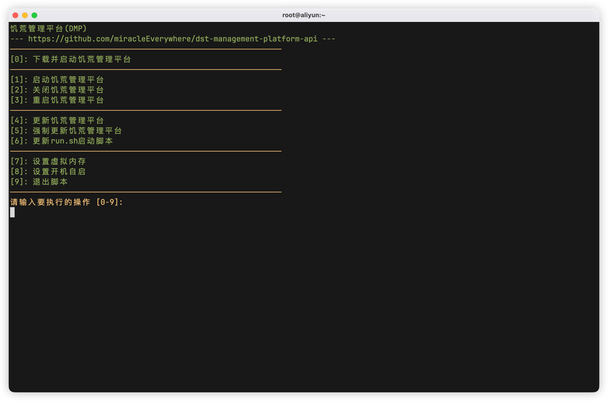
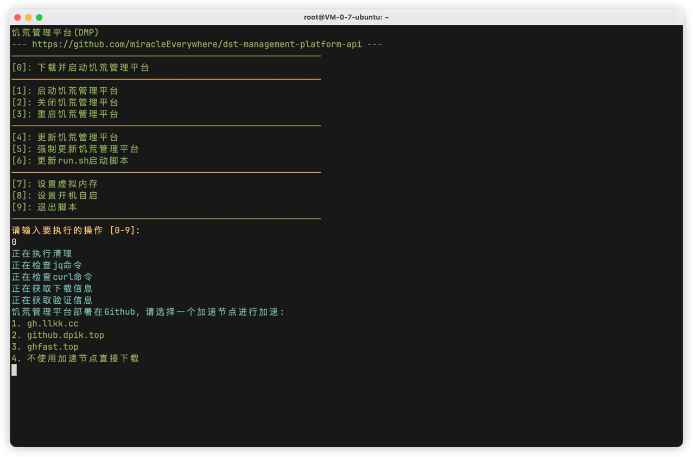
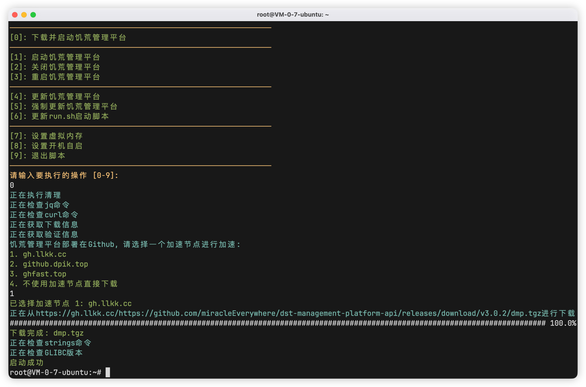
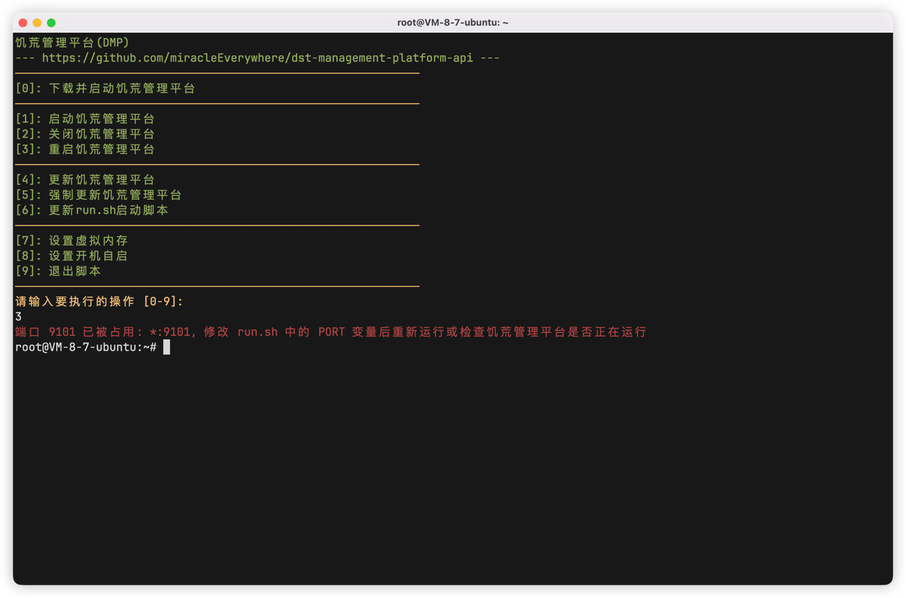
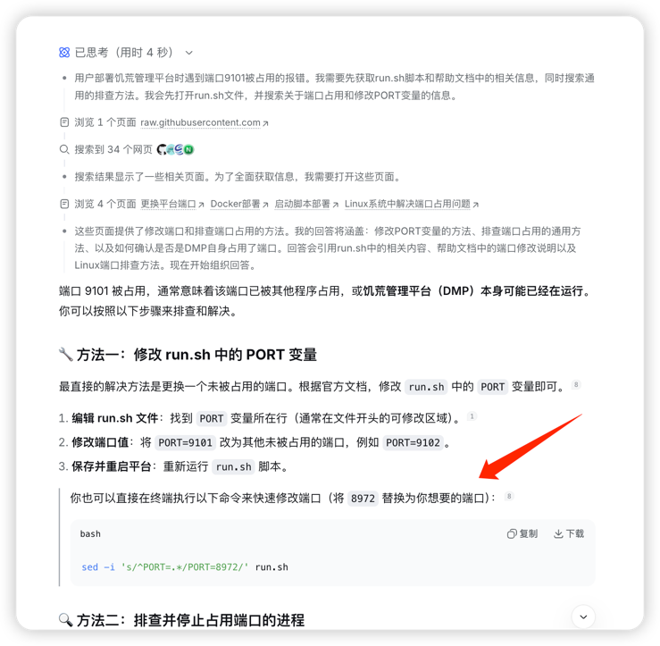
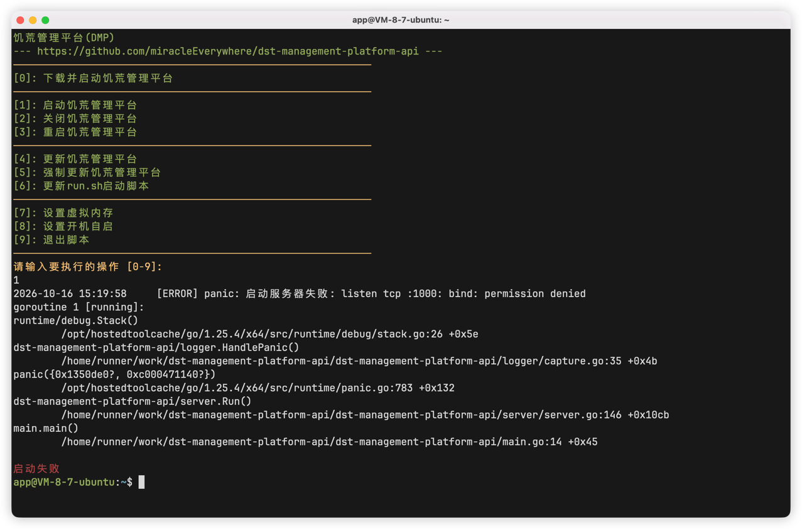
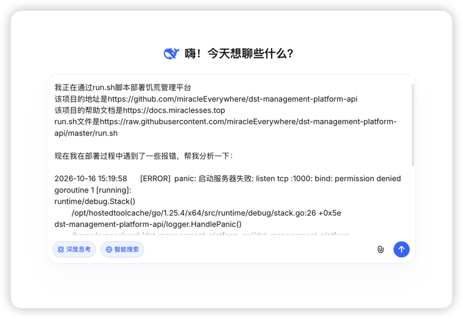
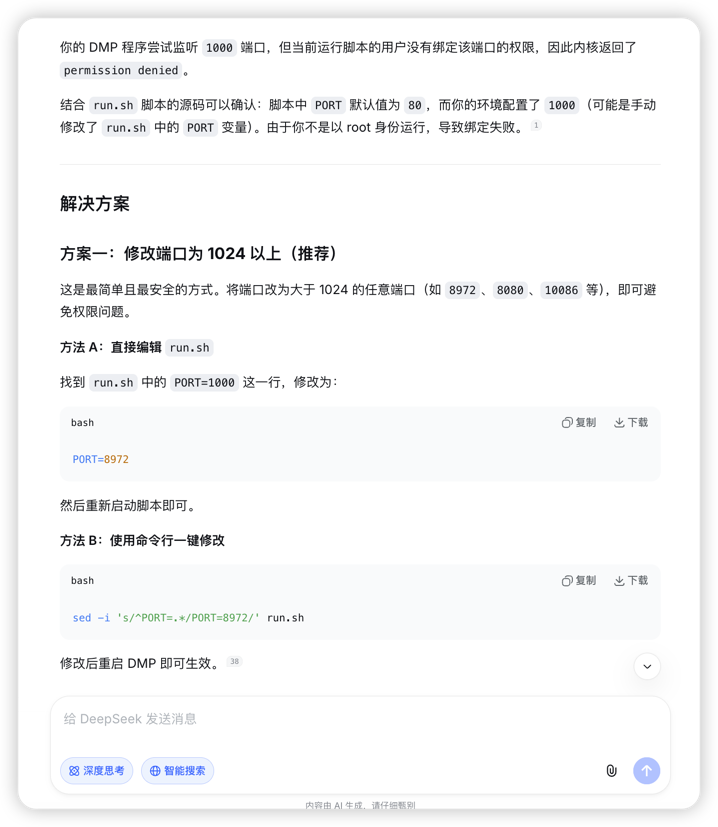

::: important
请在安装前再次确认系统版本，饥荒管理平台支持的系统有**Ubuntu24**、**Rocky9**、**Debian13**或更高版本
:::

:::info
从`v3.1.3`版本开始，饥荒管理平台不再依赖glibc库，可用更早版本的系统

但作者只测试了**Ubuntu24**、**Rocky9**、**Debian13**
:::

:::warning
由于Rocky 10不再支持32位应用，因此无法安装饥荒依赖
:::

::: danger
安装需root用户(sudo也不推荐)，安装前请再次确认当前用户是否为root，可输入命令`whoami`进行查看

如果你想使用其他用户安装，请查看[非root部署](../docs/install/no-root.md)
:::

::: info
下方教程均以腾讯云为例，其他云服厂商的操作大同小异
:::

复制下方代码，粘贴到终端并执行

:::tip
为防止粘贴异常，下方代码为base64编码，直接复制粘贴即可
如果你想查看`run.sh`源码，可对下方代码第6行进行base64解码或前往[github](https://github.com/miracleEverywhere/dst-management-platform-api/blob/master/run.sh)查看
:::

```shell title="点击右侧复制按钮" :collapsed-lines=10
cd ~

rm -f run.sh

cat > /tmp/run.sh.b64 << 'EOF'

EOF

base64 -d /tmp/run.sh.b64 > run.sh

chmod +x run.sh

rm -f /tmp/run.sh.b64

./run.sh


```

按下回车键 ⏎

如果无异常，你将会看到如下选项



输入`0`安装饥荒管理平台



这里我们输入`1`，选择1号加速节点



如果看到**启动成功**字样，那就代表安装完成了，可以进入下一步[令牌申请](token.md)了

---

:::tip
如果遇到了报错，可将报错内容喂给AI解决，无法解决可加群求助
:::

```text title="AI提示词"
我正在通过run.sh脚本部署饥荒管理平台
该项目的地址是https://github.com/miracleEverywhere/dst-management-platform-api
该项目的帮助文档是https://docs.miraclesses.top
run.sh文件是https://raw.githubusercontent.com/miracleEverywhere/dst-management-platform-api/master/run.sh

现在我在部署过程中遇到了一些报错，帮我分析一下：

{{报错内容}}
```

**示例报错1**






**示例报错2**






